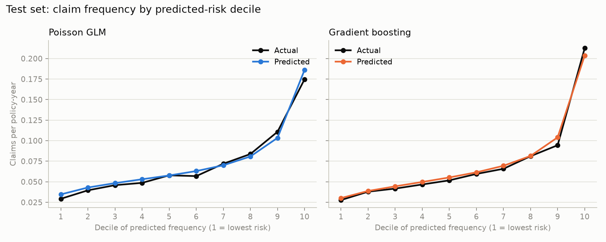
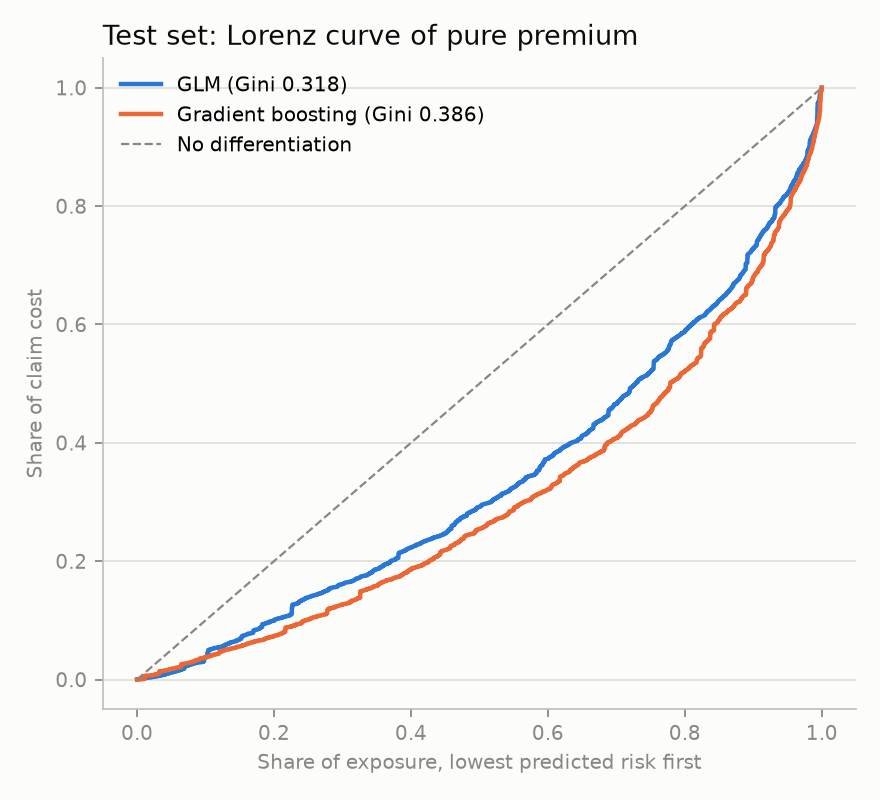

# Auto insurance claims model: GLM vs gradient boosting

Frequency-severity pricing models on 678,000 French motor third-party liability
policies (the public `freMTPL2` dataset). The data is stored in a SQL database,
cleaned and feature-engineered in SQL views, and modelled two ways: a classical
actuarial GLM and gradient-boosted trees.

**Stack:** SQL (SQLite), Python, statsmodels, LightGBM, pandas, matplotlib

## Results (held-out test set: 135,660 policies, 5,161 claims)

| Model | Frequency: Poisson deviance | Deviance explained | Frequency Gini | Pure premium Gini |
|---|---|---|---|---|
| Intercept only | 0.2484 | 0.0% | 0.000 | 0.000 |
| Poisson / Gamma GLM | 0.2366 | 4.7% | 0.293 | 0.318 |
| Gradient boosting (LightGBM) | 0.2319 | 6.6% | 0.333 | 0.386 |

| Model | Severity: Gamma deviance | Deviance explained |
|---|---|---|
| Intercept only | 1.2534 | 0.0% |
| Gamma GLM | 1.2469 | 0.5% |
| Gradient boosting | 1.2437 | 0.8% |

What the numbers say:

- **Boosting ranks risk better on frequency.** It explains 6.6% of Poisson deviance
  against 4.7% for the GLM, and is better calibrated in the riskiest decile
  (see the lift chart). The gain comes from non-linear effects and interactions
  that the main-effects GLM does not include.
- **Severity is close to unpredictable from these rating factors.** Neither model
  explains even 1% of Gamma deviance. Almost all the pricing signal is in
  frequency, which is the usual result for motor liability.
- **Bonus-malus dominates.** It accounts for 52% of the boosting model's split
  gain, and in the GLM, doubling bonus-malus (for example from 50 to 100) multiplies
  expected frequency by about 4.2.
- **Young drivers look cheap once bonus-malus is controlled for.** Raw claim
  frequency for ages 18-20 is 0.24 against 0.07 for the portfolio, but the GLM
  relativity is only 1.16, because new drivers start at a high bonus-malus and
  that variable absorbs most of the effect.
- **Test-set claims ran below the training data.** Even the intercept-only model
  over-predicts claim counts by 3% on the test set, so the similar
  over-prediction by both models is sampling variation in the split, not model bias.





## What the SQL does

| File | Purpose |
|---|---|
| `sql/01_schema.sql` | `policies` and `claims` tables with keys, constraints and an index |
| `sql/02_data_quality.sql` | Orphan claims, claim-count reconciliation, exposure and outlier checks |
| `sql/03_portfolio_analysis.sql` | Frequency, severity and pure premium by rating factor; severity percentiles and loss concentration with window functions |
| `sql/04_model_views.sql` | Train/valid/test split by hashing the policy id, capping rules, banded features, and the views the models read from |

Findings from the SQL (full output in [`results/sql_report.md`](results/sql_report.md)):

- Portfolio claim frequency is 0.074 per policy-year, average severity 2,266, pure premium 167.
- The largest 1% of claims carry 38% of total claim cost; one claim is 4.08 million.
- Capping each claim at 100,000 touches 41 claims and removes 17.7% of total cost.
- 30% of claims are one of two fixed amounts (1,204 and 1,128.12), which are flat-rate
  settlements rather than assessed losses. This is one reason severity is hard to model.
- 1,224 policies have exposure above one year and 8 have more than 4 claims; both are capped.

## Method

- **Frequency:** Poisson, log link, `log(exposure)` as offset. The GLM uses banded
  driver age, vehicle age and power, plus brand, fuel, region, log bonus-malus and
  log density. LightGBM uses the raw variables with the same offset as its starting score.
- **Severity:** Gamma, log link, on average capped cost per claim, weighted by claim count.
- **Pure premium:** predicted frequency x predicted severity.
- **Validation:** 64/16/20 train/validation/test split. The validation set is used only
  for early stopping in LightGBM; both final models are fitted on train + validation
  and scored once on test.
- **Metrics:** mean Poisson and Gamma deviance, Gini from the Lorenz curve (exposure
  weighted), and predicted vs actual by decile of predicted risk.

## Limitations

- Claims above 100,000 are capped; a real tariff would add a separate large-loss load.
- The pure premium Gini rests on 5,161 test claims with heavy-tailed costs, so the gap
  between the two models is less certain than the frequency gap.
- The GLM has main effects only. Adding a driver age x bonus-malus interaction would
  close part of the gap to boosting.
- LightGBM hyperparameters were set by hand, not tuned.

## Run it

```bash
pip install -r requirements.txt
python src/download_data.py   # fetch the two tables, save as CSV
python src/load_db.py         # build data/insurance.db and the views
python src/sql_report.py      # run the SQL checks and analysis
python src/train_models.py    # fit models, write results/
```

Runs in about two minutes on a laptop.

## Data

`freMTPL2freq` and `freMTPL2sev` from the CASdatasets R package (Dutang and
Charpentier). One table has one row per policy with exposure and rating factors;
the other has one row per claim with its amount.
